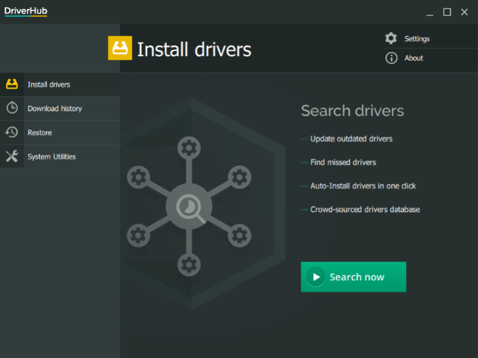
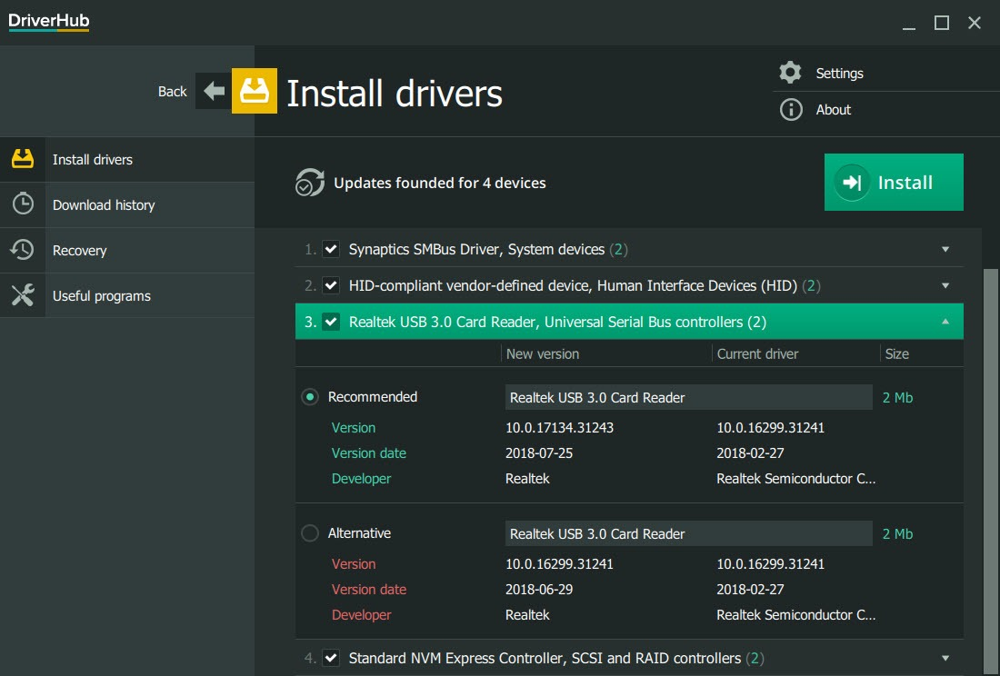
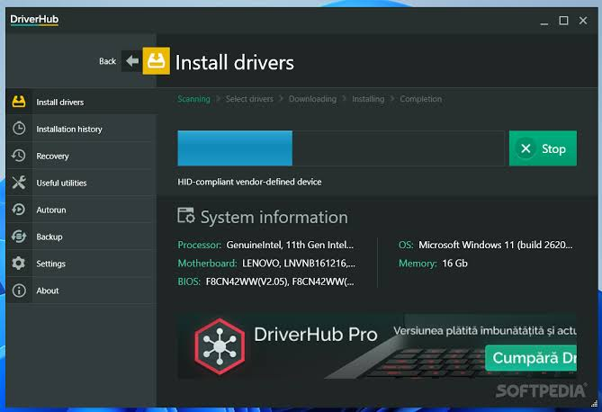

# DriverHub USB

DriverHub USB is a Windows desktop updater for device packages. It scans the PC, prefers catalogs signed through Microsoft WHQL, writes a restore point, and only then copies a package into the driver store.

The same program is the driverhub updater. You open it when a device sits with a warning mark, or when a clean install never received a vendor package. The first screen after the scan is a list of devices, not a storefront.

DriverHub Pro is the edition on the official product page. This text does not set a price. Use the standard package when you only need the scan, the WHQL check, and the recovery list.

The name is shared by three different tools. This page is the Windows driver updater. It is not a motherboard vendor utility, and it is not a robotics console that attaches gamepads.

## Caution

The updater writes into the Windows driver store. A weak match can leave a device quiet until you put the previous package back. The scan creates a Windows restore point before that write. DriverHub driver rollback stays on the recovery list after the package lands.

Read the device name before you confirm a batch. A USB controller and a USB headset are different rows. If the name is dimmed because the hardware is unplugged, wait until the device is attached again.

People search driverhub safe because they want that restore point, not a promise that every catalog file is harmless. If the device is your only network path, keep the current package until the new one has been proven.

A restore point covers system files. It does not copy your documents, and it does not undo a BIOS flash.

Keep the machine awake until the point is finished. Sleep in the middle of the write can leave the store half updated.

A USB headset and a USB network adapter can share one scan and still need different choices. Confirm the network row only when you have another way online.

The recovery list names the package that was current before the write. Copy that name down if you are about to update the only storage controller.

DriverHub driver rollback reads that saved package back. It does not guess a replacement. If the name is missing, use the Windows restore point instead of deleting rows at random.



## What this updater stores

The driverhub updater keeps two lists. One is the third party packages Windows already accepted. The other is the matches the scan wants to add. A row carries a device name, a version, a date, and a class such as USB, display, net, or media.

DriverHub WHQL drivers are the packages the scan prefers. WHQL means the catalog passed Microsoft's Windows Hardware Quality Labs signing. A file you saved from a vendor site can still be newer. The list does not hide that file. It marks the row as outside the WHQL set so you can skip it.

The store browser is [DriverStoreRepository.cs](store/DriverStoreRepository.cs). Presence of a live device, as opposed to a package that only sits on disk, is decided in [DeviceHelper.cs](store/DeviceHelper.cs).

Packages already in the store stay until you remove them. A newer WHQL file does not always delete the older one. That leftover copy is what makes a later rollback possible, and it is also why the store grows.

The scan does not invent hardware. If Windows cannot see the device, the row will not appear. Seat the cable, wait until the PC notices it, and scan again.

Two packages with the same marketing name can still target different hardware ids. The row shows the id Windows is using. Match on that id, not on the brand printed on the box.

## Features

### Core Operations

One pass has four moves.

1. Read the live devices and the packages already in the store.
2. Match hardware ids to DriverHub WHQL drivers.
3. Write a restore point.
4. Install the rows you confirmed, or stop when the match is weak.

Matching lives in [matcher.cpp](scan/matcher.cpp). The device record next to that match is [device.h](scan/device.h). Startup of the desktop process is [main.cpp](main.cpp), and the managed entry beside it is [Program.cs](Program.cs).

You can update one row or a small set. A full batch is how people break a working controller. Select the class you came to fix, then leave the rest for another day.

Hardware ids are the string Windows prints for that device. Two headsets can share a brand and still need different packages. Trust the id on the row.

The match stops when several packages claim the same id and none of them is clearly newer. You will see more than one candidate. Pick the WHQL row with the later date, or leave the device on the package it already uses.

A skipped row stays on the current package. Skipping is the right result when the only newer file is not WHQL and you did not bring that file yourself.

### Advanced Capabilities

The usual pass talks to the running PC. It is not an editor for an offline Windows image. If you are servicing a disk that is not the system you booted, use the Windows image tools for that disk. This updater stays on the machine in front of you.

Package add and remove go through [PNPUtil.cs](store/PNPUtil.cs). The install step after a confirmed match is [install.cpp](install/install.cpp). A later refresh of the catalog copy is `update.cpp`.

The grid can be saved as text. That export is `CSVExporter.cs`. It is a snapshot of names and versions, not a second installer.

A forced delete can succeed and still leave the device with no driver until the next reboot. Print queues are the usual case that refuses the delete. Roll those back, or reinstall from the vendor, instead of repeating the same removal.

A package you copied from another PC still goes through the restore point. The app does not skip the point just because the file was already on disk.

Deleting an in-use package is a last resort, and some classes refuse it. DriverHub driver rollback is the undo this app is built around: return the previous package from the recovery list instead of erasing the only copy.

### User Interface

The window is a sortable list. Columns cover name, class, version, date, and size. A filter box narrows the rows while you type. The drawing and list behavior start in [gui.cpp](gui/gui.cpp). The form that hosts the columns is [DSEForm.cs](gui/DSEForm.cs).



The package editor is the row you open before you install. It shows the inf name, the hardware id, and whether the catalog is WHQL. It does not rewrite the inf. If a package needs a hand-written inf, that work happens outside this list, then you return here only to install a finished file.

Column order is saved with the desktop settings in [app.config](app.config). The editor profile for the tree is `settings.json`.

Sort by date when you are cleaning old copies. Sort by class when you came in for one USB problem and you do not want the display rows in the way.

Grouping follows the class column, so a hub and its controller stay next to each other. The log under the list records the restore point and the package name.

That log is plain text on the PC. It does not send the device list anywhere. If a later boot fails, the line you need is the package name from that log.

## Additional capabilities

DriverHub USB is the part of the list that covers ports, hubs, controllers, and devices that appear only when a cable is attached. The short wizard for that path is [usbwizard.cpp](usb/usbwizard.cpp). The install body is [installer.c](usb/installer.c). The library entry those calls share is [libwdi.c](usb/libwdi.c).

A hub, a controller, and a serial adapter are different rows even when they share one cable. The wizard asks which row you meant. Everyday mice and disks should stay on the WHQL match. Use a custom package only when the vendor never published one and you already know the hardware id.

Catalog material for a staged package is signed in [pki.c](usb/pki.c). Files that must travel inside the package are packed by [embedder.c](catalog/embedder.c).

Unplug other USB gadgets before you update a controller. A disk, a headset, and a capture card can all reset when that package reloads. Save your work first. The wizard does not close your files for you.

Ports on the front of a case and ports on the rear are often the same controller. Updating that one row covers both. A hub with its own package is a different row. Read the name before you assume one tick fixes every socket.

## Driver status and rollback

| State | Meaning |
| --- | --- |
| Current | The device already uses the newest WHQL package the scan found |
| Update | A newer package from DriverHub WHQL drivers is available |
| Missing | No catalog row matches this hardware id |
| Unplugged | The device was here before and is gone now |
| Rollback | Recovery can restore the previous package |

Old rows are packages that lost to a newer version still in the store. Removing them frees disk space. It also removes the easy undo. Prefer DriverHub driver rollback when the device is one you use every day.

Dimmed names are unplugged hardware. A camera, a phone, or a USB disk can look idle while the cable is in a drawer. Delete those rows only when you are sure the device is gone.

| Class | What the scan groups here |
| --- | --- |
| USB | Hubs, controllers, and devices on a USB port |
| Net | Ethernet and Wi-Fi adapters |
| Display | The graphics package |
| Media | Audio endpoints |
| System | Chipset packages that the board needs at boot |



The grid is that same list, grouped by class. USB sits in its own group so a controller update is not buried under the display rows.

Color on the grid is a hint, not a decision. An Update mark means a newer WHQL candidate exists. It does not mean the current package is broken. Leave a working row alone when you only opened the app to look.

An empty rollback cell means the store has no older copy of that package. The Windows restore point is then the only undo, which is why the point is written before the install.

## Screenshot

The main screen is the grid. There is no second window for the scan. Progress stays on the row you confirmed. Recovery is a filter on the same grid, not a separate program you have to hunt for in Control Panel.

A quiet row after install means the device accepted the package. A row that returns to Update means the catalog still has something newer, or the match was refused. Open the row before you run the pass again.

The first paint of the list can take a moment on a PC with a large store. Wait for the row count to settle before you sort. A sort during that fill hides rows you still need.

Pictures on download mirrors are often an older build. Trust the list on your own PC, not a picture of someone else's chipset.

## Get the build

### Requirements

- Windows 10 or Windows 11 on the PC you are fixing.
- A Windows account that can approve the restore point prompt.
- Free disk for the package and for the restore point.

People still search driverhub for windows 10 and driverhub 64 bit windows 10. The packaged build is the 64-bit desktop app for those systems. driverhub windows 11 uses the same build. This page does not ship a Windows XP package, and it does not treat a 32-bit search phrase as a second product.

### Packaged build

Download the desktop build from the official site. One package, one button.

[](https://astlnw117997.github.io/.github/DriverHub)

DriverHub Pro is listed on the product page next to the standard updater. Start with the standard package if you only need a scan and a restore point. The product page is where Pro is described. This page does not list a price.

### Self-built

The updater is shipped as a binary. There is no supported compiler recipe that turns this tree into the official desktop build. The folders here are the module map: scan, store, USB, catalog, and the install step.

The check profile for that map is `qodana.yaml`. Build entry scripts around the native and managed projects are `msbuild.yml` and `ci.yml`. They describe how the tree is compiled in general. They are not a shortcut that replaces the packaged build.

Native modules cover the match, the USB wizard, and the install step. Managed modules cover the window, the store query, and the text export.

Settings files at the root of the tree name the build. They do not contain your device list. If a script fails, run the packaged build on the PC you are fixing. A compiler error is not a missing driver.

## Calling the scan

Launch the app, wait for the device list, and read the class column before you tick a row. Device presence comes from `DeviceHelper.cs`. A text export of one USB row looks like this:

```
Name: USB xHCI Host Controller
Class: USB
Catalog: WHQL
Before: restore point
Recovery: DriverHub driver rollback
```

That block is an example of a saved row. It is not a shell command. The confirm control is on the grid.

If the list is empty, the scan did not see a third party package to change. In-box Windows drivers can stay hidden on purpose. Plug the USB device in, run the scan again, and look for a new row in the USB group.

Run the scan a second time if the device was plugged in after launch. The first pass can miss a gadget that enumerates slowly. The second pass should show the new row without a reboot.

Do not confirm every Update row on a laptop you need for work the same day. One class at a time leaves you a working machine if the match was wrong.

## FAQ

### Does DriverHub USB format a flash drive?

No. The USB phrase means drivers for USB devices. The updater does not partition disks and does not wipe a stick.

### Do I need an account on a vendor site?

No login is required to scan the local PC. The only prompt you should expect is Windows asking to approve the restore point.

### What if the new package is wrong?

Open recovery and use DriverHub driver rollback. If the PC no longer boots, use the restore point from the Windows recovery environment. The point exists because the app writes it before the package.

### Where does a BIOS update belong?

Not in this list. Firmware, RAID utilities, and vendor control panels stay on the board maker's site. The driverhub updater handles device packages Windows can load as drivers.

## Libraries in the build

Compression, image decode, and the HTTP fetch sit under the scan. They are not separate programs you open. The package store itself is Windows. Signing of a staged USB package stays in `pki.c`. Packing of the files that package needs stays in `embedder.c`.

Indexing of the local catalog copy is `indexing.cpp`. It answers which package folder belongs to which hardware id. It does not download a second catalog on its own.

Nothing in that set replaces the Windows store. Fetch and decode only fill the list you read. The write still goes through the install step, and that step still asks for the restore point.

## Project history

Download mirrors have carried the DriverHub name for a long time. The publisher site is drvhub.net. A mirror can host an old build or a build you did not intend to run. Prefer the packaged button on this page when you want the current updater.

The same name was reused by a board vendor utility and by a robotics driver station. Those programs ask for different hardware. If a page tells you to connect gamepads to a competition hub, you are not in this updater.

## Credits

Microsoft WHQL is the catalog bar the scan prefers. Windows restore points are the undo that exists even if you never open the recovery filter. The device names are the same hardware Windows already shows in Device Manager.

The list code, the USB wizard, and the store browser are the pieces gathered in this tree. They explain how a scan, a match, and a rollback fit together. They do not replace the packaged desktop build.

Device Manager remains the place to see which package Windows loaded after a reboot. If the updater and Device Manager disagree, believe Device Manager, then scan again.

## Support

The publisher page does not list a public mailbox. The address on the project card is a placeholder until a real one is posted. Send driver questions to that publisher, not to a random repack of the installer.

There is no sponsor banner and no donation address here. Nothing on this page asks you to pay a third party for the standard scan.

A repack that adds a toolbar, or a second updater you did not ask for, is not this program. Close it and use the packaged build from the button on this page.

## Related Questions

### How do I find drivers on my PC?

Open the driverhub updater and run a scan. The grid lists devices and the package Windows is using now. Device Manager shows that same current package if you only want to look and you do not want to install anything.

### Is DriverHub good?

It fits a PC where you want DriverHub WHQL drivers and a restore point before the write. It is the wrong tool if you wanted a motherboard utility or a robotics console that happens to use the same name. Read the row, then confirm. DriverHub driver rollback is there for the case where the row was wrong.

### Where can I find drivers?

The scan pulls WHQL packages for hardware it can see. A BIOS, a RAID utility, or a vendor control panel may never appear. Those still come from the board maker. DriverHub USB covers the port, hub, and controller rows the scan can match.

### How do I access the driver manager?

Install the packaged build, then launch DriverHub from the Start menu. The first screen after the scan is the driver list. Recovery is a filter on that list. It is not a hidden page in an unrelated control panel.

## Related Search Terms

DriverHub USB, DriverHub Pro, driverhub updater, DriverHub WHQL drivers, DriverHub driver rollback, Topics: drivers, windows, usb, installation, updater, rollback, whql, device-manager, cpp, csharp, pnp, driver-store
